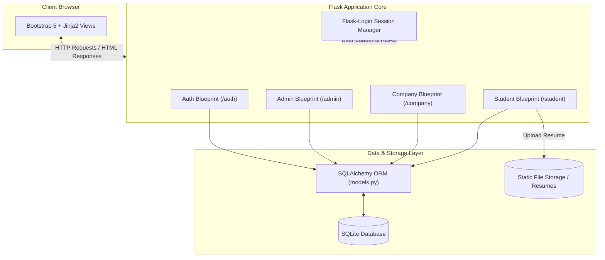

# CareerConnect

> A role-based campus placement management platform streamlining recruitment workflows for students, corporate recruiters, and placement administrators.

[](https://opensource.org/licenses/MIT)
[](https://www.python.org/)
[](https://flask.palletsprojects.com/)
[](https://www.sqlite.org/)

---

## Overview

Traditional campus recruitment relies heavily on scattered spreadsheets, manual email threads, and fragmented communication, causing duplicate applications, administrative bottlenecks, and poor visibility for candidates and recruiters. CareerConnect solves this by providing a unified, role-based platform that centralizes the recruitment lifecycle from job posting to offer generation. Built with Flask and SQLAlchemy, the system enforces backend validation, duplicate application prevention, and real-time status tracking across administrative, corporate, and student workflows. The platform improves placement processing turnaround and provides all stakeholders with transparency through structured role-specific dashboards [TODO: add metric, e.g., reducing application processing time by X%].

---

## Key Features

- **Role-Based Access Control (RBAC):** Restricts endpoints and dashboards across Student, Company, and Admin roles using unified session management with Flask-Login.
- **Placement Drive Lifecycle Management:** Enables companies to draft, configure eligibility criteria, and publish drives, while admins retain moderation and approval oversight.
- **Duplicate Application Prevention:** Enforces database-level unique constraints (`unique_student_drive`) and backend pre-checks to eliminate redundant submissions.
- **Real-Time Application Status Pipeline:** Tracks student candidates through distinct stages (`applied`, `shortlisted`, `interview`, `selected`, `rejected`) with immediate notification dispatch.
- **Centralized Placement Records:** Records confirmed hiring offers, compensation packages, and student placement histories for institutional reporting.
- **Analytics & Status Dashboards:** Visualizes applicant pipelines, status breakdowns, and historical trends via Chart.js integration.
- **Resume & Profile Management:** Allows candidates to maintain academic profiles, list skillsets, and securely upload resume documents.

---

## Architecture

CareerConnect is built on a modular Model-View-Controller (MVC) architecture powered by Flask Blueprints. The application isolates concerns into domain-specific modules (`auth`, `admin`, `company`, `student`) sharing a centralized database layer managed by Flask-SQLAlchemy. Business logic—such as eligibility validation, registration workflows, and status transitions—is strictly evaluated on the server side before persisting state, ensuring database integrity regardless of client-side operations.

### Data Flow & Component Diagram



### Tech Stack

| Layer | Technology | Purpose |
| :--- | :--- | :--- |
| **Frontend** | HTML5, CSS3, Bootstrap 5.3, Bootstrap Icons | Responsive UI and dashboard components |
| **Data Visualization** | Chart.js | Visual analytics for recruitment funnels and status breakdowns |
| **Backend** | Python 3.8+, Flask | Web server, routing, and business logic |
| **Authentication** | Flask-Login, Werkzeug Security | Session authentication, password hashing (pbkdf2:sha256), and role resolution |
| **Database & ORM** | SQLite, Flask-SQLAlchemy | Relational data persistence with strict foreign key constraints |
| **Configuration** | Python-based configuration module (`config.py`) | Environment parameters, secret keys, and upload limits |

### Project Directory Structure

```text
PlacementPortal/
├── admin/                  # Administrative operations, user audits, and drive approvals
│   ├── __init__.py         # Admin blueprint package initialization
│   └── routes.py           # Admin handlers for drives, companies, and student management
├── auth/                   # Authentication and registration services
│   ├── __init__.py         # Auth blueprint package initialization
│   └── routes.py           # Login, registration, and logout routing logic
├── company/                # Recruiter portal and candidate evaluation
│   ├── __init__.py         # Company blueprint package initialization
│   └── routes.py           # Drive creation, applicant review, and status update handlers
├── static/                 # Static web assets
│   ├── css/
│   │   └── style.css       # Custom design system tokens and responsive rules
│   └── uploads/            # File store for uploaded candidate resumes
├── student/                # Candidate portal
│   ├── __init__.py         # Student blueprint package initialization
│   └── routes.py           # Drive browsing, application submission, and profile controls
├── templates/              # Jinja2 templates partitioned by stakeholder role
│   ├── admin/              # Admin console and placement record views
│   ├── auth/               # Login and account registration forms
│   ├── base.html           # Master layout with shared navigation and sticky footer
│   ├── company/            # Drive management and applicant scoring views
│   └── student/            # Student dashboard, drive browser, and application history
├── app.py                  # Application factory, blueprint registration, and admin seeding
├── config.py               # Central environment settings and upload size limits
├── models.py               # Relational schemas (Admin, Company, Student, PlacementDrive, etc.)
└── README.md               # System documentation and deployment guide
```

---

## Getting Started

### Prerequisites

- **Python**: Version 3.8 or higher (`python3 --version`)
- **pip**: Python package manager (`pip3 --version`)
- **Git**: Version control system

### Installation & Environment Setup

1. **Clone the repository:**
   ```bash
   git clone https://github.com/anchit-goel/Placement-Portal-App.git
   cd Placement-Portal-App
   ```

2. **Create and activate a virtual environment:**
   ```bash
   python3 -m venv venv
   source venv/bin/activate
   # On Windows: venv\Scripts\activate
   ```

3. **Install dependencies:**
   ```bash
   pip install Flask Flask-SQLAlchemy Flask-Login Werkzeug
   ```

4. **Environment Configuration:**
   Create an optional `.env` file or export environment variables for custom deployments:
   ```env
   FLASK_APP=app.py
   FLASK_ENV=development
   SECRET_KEY=replace_with_a_secure_random_hex_key
   DATABASE_URL=sqlite:///placement_portal.db
   ```

### Execution Commands

- **Run in Development Mode:**
  ```bash
  python app.py
  ```
  *The app will automatically initialize database tables and seed default admin credentials on startup at `http://127.0.0.1:5002`.*

- **Default Administrator Credentials:**
  - **Username:** `admin`
  - **Password:** `admin123`

- **Run in Production (using Gunicorn):**
  ```bash
  pip install gunicorn
  gunicorn -w 4 -b 0.0.0.0:5002 "app:create_app()"
  ```

- **Run Tests / Lint Checks:**
  ```bash
  python -m py_compile app.py models.py config.py
  ```

---

## Usage

### Typical Recruitment Workflow

```text
[Company Registers] ──> [Admin Approves Company] ──> [Company Posts Drive]
                                                               │
[Student Applies] <── [Drive Goes Live] <── [Admin Approves Drive]
        │
        └──> [Company Evaluates Application] ──> [Status: Selected] ──> [Placement Record Created]
```

### Core Blueprint Endpoints

| Blueprint | Endpoint Pattern | HTTP Method | Access Level | Description |
| :--- | :--- | :--- | :--- | :--- |
| `auth` | `/login` | `GET`, `POST` | Public | Authenticates student, company, or admin users |
| `auth` | `/register/student` | `GET`, `POST` | Public | Registers a new student candidate account |
| `auth` | `/register/company` | `GET`, `POST` | Public | Submits company profile for administrative verification |
| `admin` | `/admin/dashboard` | `GET` | Admin | Displays global system metrics and platform statistics |
| `admin` | `/admin/drives` | `GET`, `POST` | Admin | Reviews, approves, or rejects proposed placement drives |
| `company`| `/company/drive/create` | `GET`, `POST` | Company | Configures new job posting and applicant eligibility criteria |
| `company`| `/company/drive/<id>/applicants` | `GET`, `POST` | Company | Reviews applicant profiles and updates selection statuses |
| `student`| `/student/drives` | `GET` | Student | Lists approved and open recruitment opportunities |
| `student`| `/student/drive/<id>/apply` | `POST` | Student | Submits candidate profile with duplicate-submission guard |

---

## Future Scope

### Short-Term
- [ ] Implement automated email notifications via SMTP/SendGrid for stage updates.
- [ ] Add `.pdf` and `.docx` client-side and server-side file format validation during resume upload.
- [ ] Add password reset flows via secure time-limited tokens.

### Mid-Term
- [ ] Introduce full-text search and multi-parameter filtering for placement drives (by CTC, location, and branch).
- [ ] Provide CSV/Excel export capabilities for admin placement records and company applicant lists.
- [ ] Migrate database engine to PostgreSQL for multi-worker production concurrency.

### Long-Term
- [ ] Build automated resume parsing to index candidate skills directly into the database.
- [ ] Implement an interview scheduling module with calendar integration (Google Calendar / iCal).
- [ ] Integrate role-based audit logging for enterprise governance and compliance tracking.

---

## Contributing

1. Fork the repository and create a feature branch (`git checkout -b feature/recruitment-optimization`).
2. Commit changes with clear, structured commit messages adhering to standard conventions.
3. Push to your branch and open a well-documented Pull Request detailing the changes and test results.

---

## License

This project is licensed under the MIT License - see the [LICENSE](LICENSE) file for details.

---

## Author

- **Anchit Goel** - *Solo Architect & Developer*
  - **GitHub:** [@anchit-goel](https://github.com/anchit-goel)
  - **LinkedIn:** [Anchit Goel](https://www.linkedin.com/in/anchitgoel5)
  - **Repository:** [Placement-Portal-App](https://github.com/anchit-goel/Placement-Portal-App)
